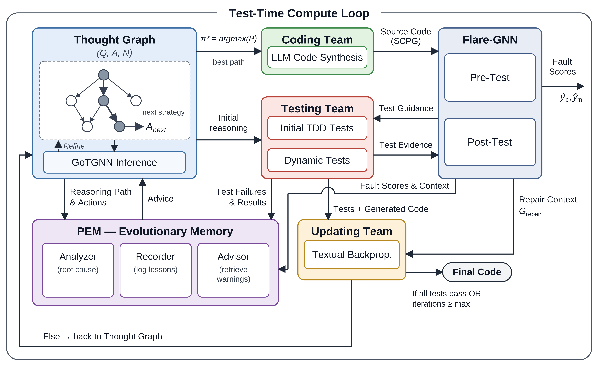

# G-CODE: Graph-Guided Reasoning and Fault Localization for Code Generation

G-CODE brings together two complementary levels of structure: the **thought level** and the **code level**. The thought level guides the reasoning process, while the code level captures the structure of the program. By connecting these two levels, G-CODE aims to improve code generation, fault localization, and repair.

## Datasets

The following publicly available datasets are used for training and evaluation:

- [rSDE-Bench](https://github.com/yuzhu-cai/rSDE-Bench) – Project-level software development tasks.
- [HumanEval](https://github.com/openai/human-eval) – Python code generation tasks.
- [BugsInPy](https://github.com/soarsmu/BugsInPy) – Real-world Python bugs and their fixes.
- [PyTraceBugs](https://github.com/acheshkov/pytracebugs) – Python defect prediction and fault localization data.
